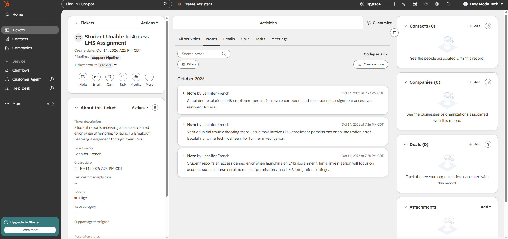
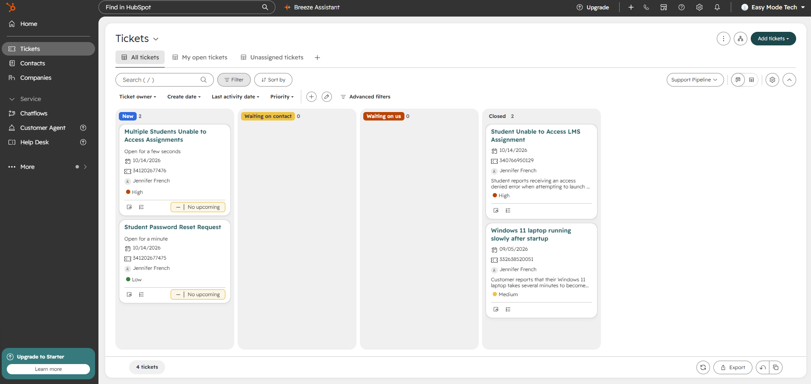

# HubSpot CRM — Technical Support Ticket Management Lab

## Overview

This project documents my hands-on experience using HubSpot CRM to manage simulated technical support requests.

I practiced ticket creation, prioritization, troubleshooting documentation, escalation, status management, and resolution using HubSpot's free CRM ticketing features.

**Platform:** HubSpot CRM (Free)  
**Focus:** Technical Support Operations, Ticket Management, Customer Experience

---

## 1. Ticket Creation and Lifecycle Management

**Objective:** Demonstrate how to manage a technical support request from initial intake through resolution.

### Scenario

A student reports receiving an access-denied error when attempting to launch an assignment through a Learning Management System (LMS).

I created a simulated support ticket titled **Student Unable to Access LMS Assignment** and configured the following:

- **Priority:** High
- **Status:** New
- **Owner:** Assigned
- **Issue:** Student unable to access an LMS assignment

### Troubleshooting Documentation

I added internal notes outlining the initial investigation:

- Verify account status.
- Check course enrollment.
- Review user permissions.
- Investigate potential LMS integration issues.

I then advanced the ticket through the support workflow and documented a simulated escalation for further technical investigation.

### Resolution and Closure

To complete the exercise, I documented a simulated resolution in which the student's enrollment permissions were corrected and assignment access was restored.

I changed the ticket status to **Closed**.

**Result:** Successfully demonstrated ticket creation, internal documentation, escalation, and closure.

*Note: This was a simulated support scenario. No actual student accounts, permissions, or production LMS integrations were modified.*

---

## 2. Ticket Prioritization and Queue Management

**Objective:** Demonstrate how to organize and prioritize multiple incoming technical support requests.

### Scenario

I created two additional simulated support tickets:

| Ticket | Priority | Initial Status |
|---|---|---|
| Multiple Students Unable to Access Assignments | High | New |
| Student Password Reset Request | Low | New |

The first issue affected multiple students and was treated as more urgent than an individual password reset.

I used HubSpot's ticket board to review both requests and their priority levels.

### Escalation Workflow

I moved the high-priority ticket to **Waiting on us** and documented a potential LMS integration problem affecting multiple students.

The ticket remained open to represent an issue awaiting further technical investigation.

**Result:** Demonstrated ticket prioritization, queue organization, status changes, and escalation documentation.

---

## 3. Support Workflow Concepts

The lab covered several core technical support practices:

- **Ticket intake:** Creating records for incoming customer issues.
- **Prioritization:** Identifying issues requiring faster attention.
- **Documentation:** Maintaining clear internal troubleshooting notes.
- **Escalation:** Identifying problems requiring additional technical investigation.
- **Status management:** Tracking requests through different support stages.
- **Resolution:** Recording outcomes and closing completed requests.

## 4. Lab Environment and Limitations

This project was completed using **HubSpot's free CRM ticketing interface**.

The dedicated HubSpot Service Hub Help Desk workspace was not available under the free account.

Therefore, this project demonstrates ticket management through the CRM Tickets interface rather than the paid Help Desk workspace.

All tickets and customer issues were simulated for learning purposes.

---

## Key Takeaways

This lab reinforced my ability to organize support requests, document troubleshooting activities, identify escalation needs, and manage ticket workflows within a cloud-based CRM platform.

It also provided practical experience with HubSpot's ticketing interface and support operations commonly used by customer experience teams.

## Conclusion

With over 20 years of experience in IT technical support and customer service, I continually look for opportunities to expand my familiarity with modern support platforms.

This project demonstrates my hands-on exploration of HubSpot CRM and my approach to organized, accurate, and customer-focused technical support.
